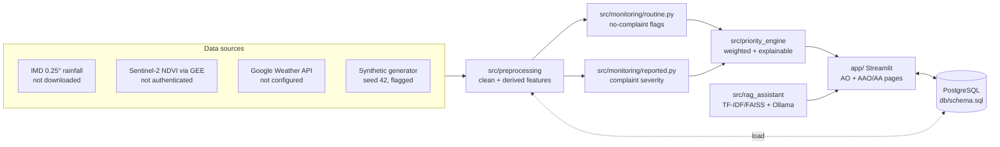

# AgriResolve AI

**AI-powered decision support for an Agriculture Officer (AO): which villages should be inspected first?**
The AI recommends, the AO decides. Built as a college mini-project with a fixed Python stack
(Python · Streamlit · PostgreSQL · Pandas · NumPy · scikit-learn · Earth Engine/Sentinel-2 ·
IMD rainfall · Google Maps/Routes/Weather · Plotly · Ollama · Sentence Transformers · FAISS · PyMuPDF).

> ⚠️ **This prototype runs on synthetic data with a simulated RSK-village mapping.**
> No number here is a government observation and no accuracy claim is made. Google Earth Engine
> and the Google Maps Platform APIs are **not integrated yet** (see [docs/api_setup.md](docs/api_setup.md)).

## What it does

IDENTIFY → PRIORITISE → COORDINATE

1. **Identify** villages at risk *without waiting for a complaint*: rainfall deficit vs an 8-year
   baseline, Sentinel-2 NDVI decline, unusual vegetation change, heat/dry weeks, inspection recency
   and data reliability (routine monitoring).
2. **Identify** villages from **farmer complaints**: urgency, category, affected area, repeats,
   waiting time (reported-issue monitoring).
3. **Prioritise** with one transparent weighted engine. Every score decomposes into six visible
   factor contributions, duplicates are counted once, and a sensitivity run shows how fragile the
   ranking is. Staff capacity decides how many villages can actually be covered.
4. **Coordinate**: the AO approves a priority and assigns an AAO/AA; the field officer sees only
   their own assignments, can register a new farmer issue, and can ask the retrieval-based field
   assistant for an inspection checklist with document + page citations.

## Run it

```bash
# 1. environment (Python 3.13)
py -3.13 -m venv .venv
.venv\Scripts\pip install -r requirements.txt      # macOS/Linux: .venv/bin/pip

# 2. data + engine outputs (synthetic, seeded, reproducible)
.venv\Scripts\python -m src.utils.pipeline

# 3. the website
.venv\Scripts\streamlit run app/streamlit_app.py
```

Open http://127.0.0.1:8501 — pick the **AO** or **AAO/AA** role in the sidebar.

Optional: `python -m db.load --init --results` loads everything into PostgreSQL (needs `DB_*` in
`.env`, see [docs/db_design.md](docs/db_design.md)). Without it the app runs in a clearly-labelled
CSV demo mode; form submissions then live in memory for the session only.

## Architecture



## Repository layout

```
docs/            design + data-source + assumption documents
data/raw         untouched originals (git-ignored, download with src/ingestion/download_public_data.py)
data/cleaned     pipeline output, reproducible
data/derived     features, monitoring results, priority scores, sensitivity
data/synthetic   committed synthetic tables (every row flagged is_synthetic)
db/              schema.sql, loader, setup notes
src/             config, ingestion, preprocessing, monitoring, priority_engine, rag_assistant, utils
app/             Streamlit entry point + views (AO pages, AAO/AA page)
notebooks/       EDA notebook
tests/           19 unit tests
guidelines_pdfs/ official PDFs (git-ignored) + one labelled internal demo note
```

## Honesty rules this repo follows

| Rule | How it is enforced |
|---|---|
| Synthetic data never disguised as real | every row has `is_synthetic`/`data_type`; UI banner on every page |
| Simulated RSK mapping labelled | `villages.source_status = 'simulated'`, `rsk.mapping_status = 'simulated'`, text in the UI |
| No invented sources or numbers | `docs/data_sources.md` lists only verified URLs; unavailable sources are marked "not downloaded" |
| Explainable prioritisation | weights live in `src/config/*.yaml`; factor contributions are stored and charted |
| No accuracy claims from synthetic data | no model is trained; the engine is rule/weight based |
| Secrets stay out of git | `.env` git-ignored, `.env.example` placeholders only, README/docs never contain keys |

## Project status

| Phase | Scope | State |
|---|---|---|
| 1 | Repo inspection, identity, env readiness | done — [docs/repo_audit.md](docs/repo_audit.md) |
| 2 | RSK + village selection | done as **simulated** — [docs/rsk_selection.md](docs/rsk_selection.md) |
| 3 | Data sources + API setup | documented, APIs not enabled — [docs/data_sources.md](docs/data_sources.md), [docs/api_setup.md](docs/api_setup.md) |
| 4 | Ingestion + synthetic data | synthetic done; IMD/GEE/Weather clients written, not run (no credentials) |
| 5 | Cleaning + derived features | done, tested — [docs/data_quality_report.md](docs/data_quality_report.md) |
| 6 | PostgreSQL schema + loader | schema + loader done; **not loaded** (no DB password supplied) |
| 7 | EDA | notebook + [docs/eda_findings.md](docs/eda_findings.md) |
| 8 | Routine monitoring | done, tested, configurable thresholds |
| 9 | Reported-issue monitoring + complaint validation | done, tested |
| 10 | Combined priority engine, dedupe, sensitivity, capacity | done, tested — [docs/priority_engine_design.md](docs/priority_engine_design.md) |
| 11 | AO dashboard | done (map, tables, explanations, approvals, assignment, capacity) |
| 12 | AAO/AA dashboard | done (own assignments, complaint form with validation) |
| 13 | AI field assistant | working on a demo corpus in TF-IDF + Ollama mode — [docs/rag_evaluation.md](docs/rag_evaluation.md) |
| 14 | Integration testing | unit tests pass; end-to-end walkthrough documented — [docs/demo_walkthrough.md](docs/demo_walkthrough.md) |
| 15 | Documentation | this README + `docs/` |

## Current demo output (reference date 2026-11-24, synthetic)

| Rank | Village | Priority | Band | Why |
|---|---|---|---|---|
| 1 | Keralapura | 62.3 | Inspect first | season rainfall 323 mm vs 665 mm baseline (−51 %), 220 days since inspection, drought complaints |
| 2 | Bilikere | 47.6 | High | 4 pest complaints, critical severity; routine NDVI decline |
| 3 | Hanagodu | 45.3 | High | 3 flood/disease complaints, +37 % excess rainfall |
| 4 | Gavadagere | 43.5 | High | low data reliability (0.48) + long inspection gap |
| 5 | Doddabyranakuppe | 42.4 | High | canal/irrigation complaints, rainfall −21 % |
| 6 | Uyyamballi | 42.4 | High | moderate pest complaints |

## Scope exclusions (deliberately not built)

Farmer login/farmer app, post-inspection report submission, issue-resolution tracking,
follow-up management, multi-RSK administration, chatbot inside the priority engine.

## Limitations

- All observations are synthetic; the RSK-village mapping is simulated.
- Earth Engine, Google Weather/Routes/Maps and IMD are integrated as code paths only, never run
  here — NDVI, rainfall and weather numbers are generated, not measured.
- The assistant's corpus is one internal demo note; retrieval-mode differences are documented.
- PostgreSQL mode is implemented but unverified: the local server needs a password.
- Role selection is a prototype switch, not authentication.

## Tests

```bash
.venv\Scripts\python -m pytest tests -q      # 19 passed
```

## Licence

Not chosen yet — ask before publishing (master instructions require the owner's decision).
