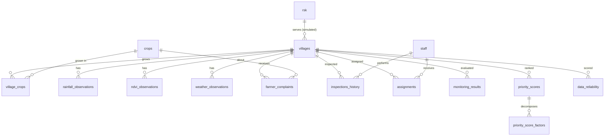

# Phase 6 — PostgreSQL design

Schema: `db/schema.sql` · Loader: `db/load.py` · Access layer: `src/utils/data_access.py`.

> **Status: not loaded.** The local PostgreSQL 18.1 server is running on `127.0.0.1:5432`, but the
> role/password is not configured in `.env`, so the schema has not been executed against a live
> database. The app therefore runs in its labelled CSV demo mode. Nothing below is claimed as tested
> against a server.

## Entity–relationship diagram



## Tables

| Table | Purpose | Key constraints |
|---|---|---|
| `rsk` | the Raitha Samparka Kendra | `mapping_status ∈ (verified, simulated)` |
| `villages` | village master with simulated/verified flag | unique `lgd_code`, `cultivated_area_ha > 0`, FK to `rsk` |
| `crops`, `village_crops` | crop master and per-village area | composite PK, `area_ha > 0` |
| `rainfall_observations` | monthly rainfall | unique (village, year, month), `rainfall_mm ≥ 0` |
| `ndvi_observations` | monthly NDVI with cloud context | `ndvi_mean` may be NULL (cloud gap), unique (village, year, month) |
| `weather_observations` | weekly weather | unique (village, week_start) |
| `farmer_complaints` | registered issues | category/urgency/status enums via CHECK, nullable crop id and area |
| `inspections_history` | past inspections | FK to village and staff |
| `staff` | AO/AAO/AA roster and workload | `role ∈ (AO, AAO, AA)` |
| `assignments` | approved priority → field officer | `due_date ≥ assigned_date` |
| `monitoring_results` | routine + reported engine output | unique (run_date, village, trigger), `factors JSONB` |
| `priority_scores` | ranked village output, approval fields | unique (run_date, village), score 0–100 |
| `priority_score_factors` | per-factor decomposition | unique (priority_id, factor), values 0–1 |
| `data_reliability` | per-village reliability snapshot | unique (village, as_of) |
| `guideline_documents` | metadata for RAG PDFs | licence/URL recorded per document |

Every observational table carries `is_synthetic BOOLEAN` and
`data_type ∈ (Real, Derived, Synthetic)`, and a `created_at` timestamp. Indexes cover all
village/date access paths used by the app (`idx_priority_run`, `idx_complaints_village_date`, …) and
the view `v_village_priority_latest` returns the most recent run with approval state.

## Setup (local)

```sql
-- as a superuser
CREATE ROLE agriresolve_app WITH LOGIN PASSWORD 'choose-a-strong-password';
CREATE DATABASE agriresolve OWNER agriresolve_app;
```

```dotenv
# .env  (git-ignored)
DB_HOST=localhost
DB_PORT=5432
DB_NAME=agriresolve
DB_USER=agriresolve_app
DB_PASSWORD=choose-a-strong-password
```

```bash
python -m src.utils.pipeline          # produce the CSVs first
python -m db.load --init --results    # schema + data + monitoring/priority results
```

`--init` applies `db/schema.sql` (it drops and recreates the project's own tables; it never touches
other schemas). `--results` also writes `monitoring_results`, `priority_scores`,
`priority_score_factors` and `data_reliability` for the configured reference date.

## Verification queries

```sql
SELECT count(*) FROM villages;                                    -- 6
SELECT count(*) FROM farmer_complaints;                           -- 16
SELECT * FROM v_village_priority_latest ORDER BY rank;            -- ranked list
SELECT v.village_name, p.factor, p.factor_value, p.contribution
FROM priority_score_factors p
JOIN priority_scores s ON s.priority_id = p.priority_id
JOIN villages v ON v.village_id = s.village_id
WHERE v.village_name = 'Keralapura'
ORDER BY p.contribution DESC;                                     -- explanation data
SELECT data_type, count(*) FROM farmer_complaints GROUP BY 1;     -- all 'Synthetic'
```

## Write path used by the app

`Repository` (`src/utils/data_access.py`) is the only database client in the app:

- reads: SQLAlchemy `pd.read_sql_table`; writes: parameterised `text()` statements (no string
  concatenation of user input);
- `add_complaint` / `add_assignment` / `approve_village` persist to PostgreSQL when configured;
- in CSV demo mode those writes are kept in a process-memory buffer and the UI says so — this is a
  demo convenience, not a second database.

## What still needs doing

1. Supply the database password so `db/load.py --init --results` can be executed and verified.
2. Add a migration story (currently the schema is idempotent-by-drop, fine for a project demo but not
   for production).
3. Move the approval/assignment write path behind a tiny service layer if the project grows beyond one
   Streamlit process.
